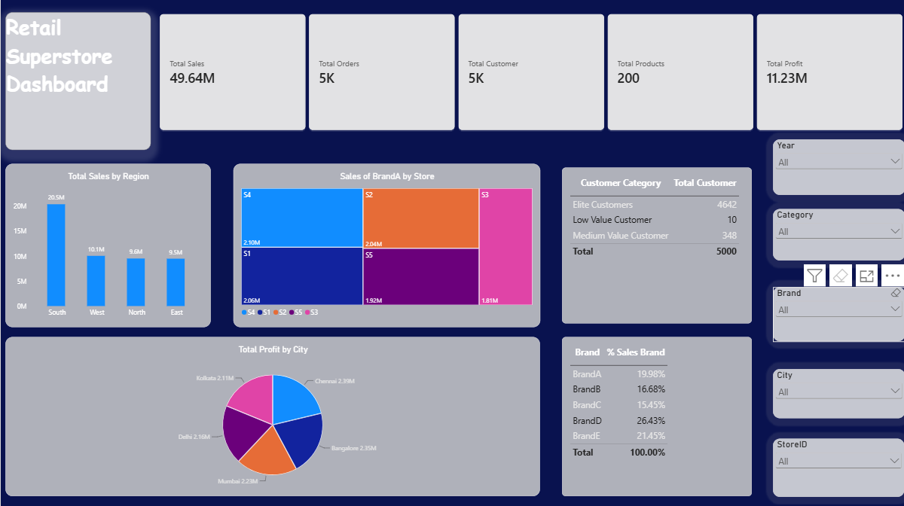
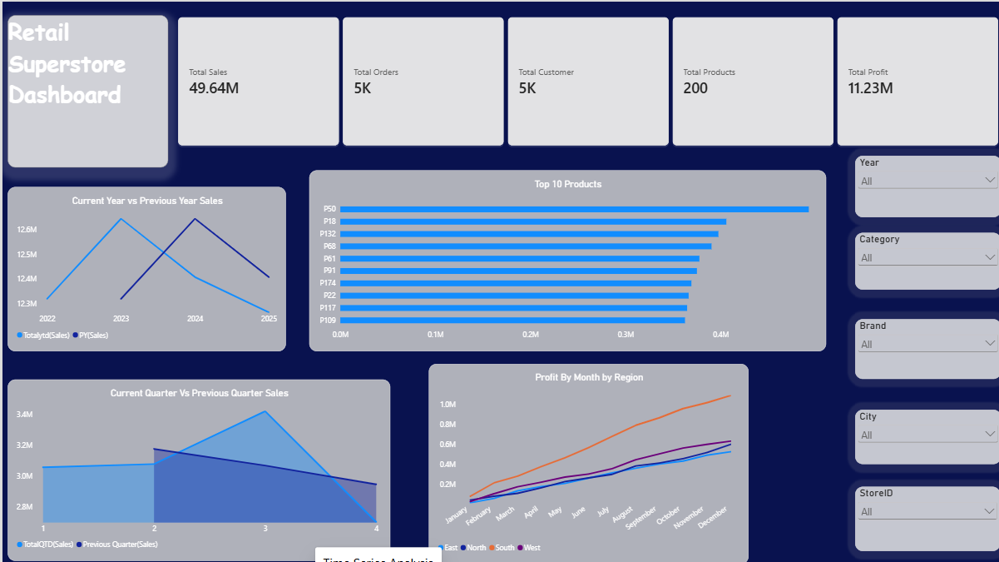

# 📊 Retail Sales Analysis Dashboard – Power BI

An interactive **Retail Sales Analytics Dashboard** built using Microsoft Power BI to analyze sales, profit, customers, products, stores and time-based performance.

## 📌 Project Overview

This project transforms retail sales data into an interactive business intelligence dashboard.

The dashboard consists of two main pages:

- **Overview** – Provides a high-level summary of retail performance using KPIs and business visualizations.
- **Time Series Analysis** – Analyzes sales and profit trends over time and compares performance across different periods.

## 🎯 Objectives

- Analyze overall sales and profit performance
- Track important business KPIs
- Compare regional sales performance
- Analyze store and brand performance
- Understand customer categories
- Identify top-performing products
- Analyze sales and profit trends over time
- Compare current and previous-year performance
- Compare current and previous-quarter performance

## 🛠️ Tools & Technologies

- **Power BI**
- **Power Query**
- **DAX**
- **Data Modeling**
- **Time-Series Analysis**

## 📊 Dashboard Pages

### 1. Overview

The Overview dashboard provides a consolidated view of retail business performance.

### Key KPIs

- **Total Sales:** 49.64M
- **Total Orders:** 5K
- **Total Customers:** 5K
- **Total Products:** 200
- **Total Profit:** 11.23M

### Analysis Included

- Total Sales by Region
- Sales by Brand and Store
- Customer Category Analysis
- Total Profit by City
- Brand Sales Contribution
- Interactive filtering by Year, Category, Brand, City and Store

### Dashboard Preview



---

### 2. Time Series Analysis

The Time Series dashboard focuses on understanding changes in business performance over time.

### Analysis Included

- Current Year vs Previous Year Sales
- Current Quarter vs Previous Quarter Sales
- Top 10 Products
- Monthly Profit by Region
- Year-based analysis
- Category, Brand, City and Store filtering

### Dashboard Preview



---

## 🧩 Data Model

The project uses a dimensional data model with:

- **Fact Sales**
- **Dim Calendar**
- **Dim Customer**
- **Dim Store**
- **Dim Product**

This structure enables analysis of sales across different business dimensions.

## 📈 Key Business Analysis

### Sales Performance
- Regional sales comparison
- Store-level sales performance
- Brand contribution
- Product-level sales

### Profitability
- Overall profit
- City-wise profit
- Regional profit trends
- Monthly profit analysis

### Customer Analysis
- Customer categories
- Customer distribution

### Product Analysis
- Top 10 products
- Brand performance
- Product-level sales

### Time Analysis
- Year-over-year comparison
- Quarter-over-quarter comparison
- Monthly trends
- Year-to-date analysis

## 📁 Repository Contents

```text
Retail-Sales-Analysis-PowerBI/
│
├── README.md
├── Retail_Sales_Analysis.pbix
├── Overview.png
└── Time-Series-Analysis.png
```

## 💡 Project Takeaway

This project provided practical experience in **Power BI dashboard development, data modeling, Power Query, DAX, KPI creation, data visualization and time-series analysis**.

It demonstrates how retail data can be transformed into an interactive dashboard to support data-driven business analysis.

## 👨‍💻 Author

**Anishzd14**

MTech Computer Science Engineering
